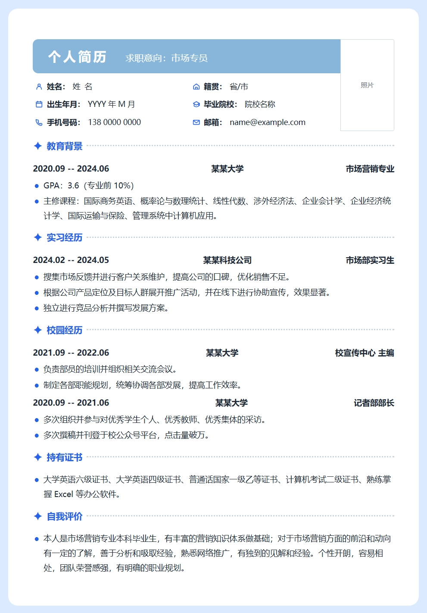

# ResumeKit · 简历模板工具包

> 把 Markdown / HTML 简历源文件做成 A4 简历,支持浏览器内拖拽自调、零依赖、零服务、隐私隔离。

[](./LICENSE)


如果你使用 Markdown 编辑好了一份简历的文字内容，但苦于怎么更好的展现，这个 ResumeKit 一定适合你


---

## ✨ 核心特性

- 🎨 **多套开箱即用模板** — 覆盖简约 / 商务 / 清新 3 种风格,适配互联网 / 金融 / 制造 / 教师 / 文化传媒 5 个行业,主色黑 / 蓝 / 紫多色可选，且可自由搭配（如果没有喜欢或合适的，可以和AI交流让其基于模板修改新的，欢迎提交）
- 🖱 **拖拽自调** — 浏览器里直接拖元素调间距、双击改文字,所见即所得,不需要任何 IDE
- 📋 **参数化导出** — 调整结果可导出 JSON,AI 一键应用,二次微调时无需从头再来
- 🖨 **A4 直出 PDF** — 走浏览器原生「打印 → 另存为 PDF」,屏幕预览与打印共享布局,排版零损耗
- 🔒 **零依赖、零网络** — HTML / CSS / JS 全部内联,无 CDN、无打包工具、无外部资源请求
- 🛡 **隐私隔离** — `source/`(源文件)、`temp/`(草稿)、`prospect/`(成品)三个目录默认 git 忽略,本地的个人简历不会被提交

---

## 📸 预览

> 现有的从网络渠道模仿和延申的简历模板在`template/`下，可直接用浏览器查看
> 


---

## 🚀 快速开始

### 环境要求

- 任意现代浏览器(Chrome / Edge / Firefox / Safari 任一)
- 任意文本编辑器(VSCode / Sublime / 记事本都行)
- 无需 Node.js、无需 Python、无需任何构建工具

### 5 分钟上手

```bash
# 1. 克隆仓库
git clone https://github.com/xingmangHi/ResumeKit.git
cd ResumeKit

# 2. 在浏览器里打开任意一份模板看效果
# Windows
start "template\简约_互联网_黑.html"
# macOS
open template/简约_互联网_黑.html
# Linux
xdg-open template/简约_互联网_黑.html

# 3. 复制已有的 Markdown 格式简历到 `source/` 文件夹下

# 4. 使用 AI 协作（见下方"AI 协作使用"章节）
```

---

## 🤖 AI 协作使用

ResumeKit 提供通用的 **简历美化 Skill**，适用于各类 AI 产品。

### Skill 文件位置

- **主入口**：`SKILL.md` — 工具无关、简洁可执行
- **完整规则**：`RULES.md` — 简历业务规则权威源

### 不同 AI 产品的使用方法

**重要**：并非所有 AI 产品都会自动发现或读取 Skill 文件。

| AI 产品 | 使用方法 | 支持情况 |
|---------|---------|---------|
| **Cursor** | 在 Chat 中 @ 引用 `SKILL.md` 或根目录，或直接要求 AI 阅读 | 需手动引用 |
| **Claude Code** | 可能自动读取 `.claude/skills/` 下的 Skill（需验证） | 部分自动 |
| **其他 AI** | 在对话中明确要求 AI 阅读 `SKILL.md` 和 `RULES.md` | 通常需手动 |

### 推荐使用步骤

1. **手动引用**：在对话开始时明确要求 AI 阅读 `SKILL.md` 和 `RULES.md`
2. **能力确认**：要求 AI 声明具备的能力（文件操作、浏览器渲染、PDF 生成等）
3. **规则确认**：要求 AI 确认已理解核心约束（内容保真、A4 固定、共享布局等）

示例对话开场：

```
请阅读 SKILL.md 和 RULES.md，声明你具备的能力（文件操作、浏览器、PDF 生成），
然后帮我美化 source/my-resume.md 这份简历。
```
---

## 📖 使用方法

### 工作流概览

```
1. 启动确认:风格 / 行业 / 颜色 / 布局 / 页数 + 字段抽取 + 模板选择
2. 制作与调整:填充数据、协调排版
3. [可选] 浏览器自调:拖拽、编辑、导出 JSON
4. 交付确认:最终 HTML + 检查结果 + 文件名
```

> 详细规则见 [`RULES.md`](./RULES.md)。AI 协作入口见 [`SKILL.md`](./SKILL.md)。

### 拖拽脚本速查

打开 `temp/<时间戳>/draft.html` 后,内联的拖拽脚本会启用以下操作:

| 动作 | 效果 |
|---|---|
| 鼠标按下移动 < 5px | 视为文字选中 / 光标定位(不触发拖动) |
| 鼠标按下移动 ≥ 5px | 进入拖动,元素跟随鼠标移动(用 `transform` 视觉反馈) |
| 松开鼠标 | 把累计位移落到元素的 `margin-left` / `margin-top` |
| 双击文字 | 直接进入编辑模式(`contenteditable`) |
| 点右上「📋 导出调整参数」或按 `C` | 导出 JSON 到剪贴板 |
| 点右上「🗑 清本地数据」 | 清掉 localStorage 里的所有调整记录 |

JSON 格式:

```json
{
  "type": "resume-drag-adjustments",
  "template": "简约_互联网_黑",
  "source_file": "temp/2026-06-20-16-10/draft.html",
  "timestamp": "2026-06-20 16:35:12",
  "summary": { "margin_changes": 3, "text_changes": 2, "total": 4 },
  "changes": [
    { "selector": "span.banner-name", "style": { "margin-left": "20px", "margin-top": "-3px" } },
    { "selector": "span.banner-name", "text": { "old": "姓  名", "new": "张三" } }
  ]
}
```

把 JSON 粘回对话给 AI,AI 会自动应用调整到 `draft.html` 并复述你改了什么。

---

## 🎨 模板规范

如果你要**新增**或**修改**模板,请遵守以下规范:

- **文件命名**:`{风格}_{行业}_{主色调}.html`,如 `简约_金融_黑.html`
- **单文件 HTML**:CSS 内联或写在 `<style>` 内(便于打印)
- **A4 优化**（关键约束）:
  - 纸张盒固定 `width: 210mm; height: 297mm;`（**`height` 不是 `min-height`**）
  - 禁止纸张盒随内容撑高
  - `@page { size: A4 portrait; margin: ...; }` 声明必须有
  - 屏幕预览与打印必须共用相同的字体、字号、行高、版心宽度、间距
  - `@media print` 仅可移除外装饰和设置必要分页，**不能**单独改字号/行高/间距/颜色
- **零外部资源**:不用 CDN 字体、不用外链图片,所有资源内联
- **CSS 变量**:颜色、间距、字号等用 CSS 变量定义(便于复用)
- **不含拖拽脚本**:拖拽脚本只在 `temp/` 阶段的 draft.html 里使用,**不要**写进 `template/`
- **占位符约定**:见 [`RULES.md` §1.2.1](./RULES.md)
- **Markdown 标签样式**:`<strong>` / `<em>` / `<code>` / `<a>` / `<blockquote>` 等语义标签必须有基础样式,见 [`RULES.md` §1.6.9](./RULES.md)

### 当前模板清单

| 模板 | 风格 | 行业 | 主色 |
|---|---|---|---|
| `简约_互联网_黑` | 简约 | 互联网 | 黑 |
| `简约_互联网_蓝黑` | 简约 | 互联网 | 蓝黑 |
| `简约_金融_黑` | 简约 | 金融 | 黑 |
| `简约_制造业_紫` | 简约 | 制造业 | 紫 |
| `简约_文化传媒_蓝` | 简约 | 文化传媒 | 蓝 |
| `简约_读研_蓝` | 简约 | 读研 | 蓝 |
| `商务_互联网_蓝` | 商务 | 互联网 | 蓝 |
| `清新_教师_紫` | 清新 | 教师 | 紫 |

---

## 🤝 贡献

欢迎 PR!主要的贡献方向有三种:

### 1. 新增模板

1. Fork → 新建分支 `feat/template-<描述>`,如 `feat/template-tech-cyber-green`
2. 仿照 `template/` 下任意一份创建新文件,遵守 [§ 模板规范](#-模板规范)
3. 本地验证 checklist:
   - 浏览器打开,布局正常
   - 把姓名改成一个超长字符串(如 20 个汉字),看会不会溢出
   - Ctrl+P → 实际打印预览,确认一页 A4 内,无内容被切
4. 提交 PR,描述里附:
   - 模板定位(目标行业 / 风格)
   - 浏览器打印预览截图
   - 用什么字体 / 配色参考

### 2. 改进拖拽脚本

拖拽脚本目前内联在 `temp/<时间戳>/draft.html` 末尾。要改进它,先在 temp 目录新建一份 draft.html 改,然后把你修改后的整段 `<script>` 贴到 PR 里说明。**(注意:不要把脚本写进 `template/` 下任何文件。)**

### 3. 修正 / 改进工作流

工作流定义在 [`RULES.md`](./RULES.md)。如果发现流程有 bug 或可优化:

- **小改动**(错别字、表述不清晰):直接 PR
- **结构性改动**(改流程、新增阶段):先开 Issue 讨论,确认方向后再 PR

### 提 Issue

- Bug 报告:附浏览器版本 + 操作系统 + 复现步骤 + 期望 vs 实际
- Feature Request:说清楚解决什么问题、目标用户是谁、你的方案是什么
- 模板建议:说明目标行业 / 风格,最好附参考样例

> 注：由于本人对PR和Issue的流程并不熟悉，前面的要求由AI生成，实际以可读可理解为第一要求

---

## 🗂 目录结构

```
ResumeKit/
├── docs/                     # 项目说明与预览截图
│   └── screenshots/          # README 引用的预览图
├── source/                   # 你的简历源文件(.md / .html),不入 git
│   └── .gitkeep              # 保留目录壳子(隐私机制)
├── temp/                     # 草稿(填内容 + 自调阶段),不入 git
│   └── .gitkeep
├── prospect/                 # 最终成品 HTML(可直接打印 / 导出 PDF),不入 git
│   └── .gitkeep
├── template/                 # 模板库(单文件 HTML,纯 HTML/CSS,无脚本)
├── SKILL.md                  # AI 简历美化 Skill 主入口
├── AGENTS.md                 # 仓库维护简要指南
├── RULES.md                  # 简历业务规则权威源(强制)
├── README.md                 # 本文件
├── LICENSE                   # MIT License
└── .gitignore                # 隐私目录 + .gitkeep 白名单
```

> **隐私设计说明**:`source/`、`temp/`、`prospect/` 三个目录通过 `.gitignore` + `.gitkeep` 实现:
> - 目录壳子被 git 跟踪,clone 后能拿到完整结构
> - 任何放进这三个目录的**实际文件**都不会被 git 跟踪,本地的个人简历永远不会被提交
> - `.gitkeep` 是空占位文件(0 字节),白名单豁免后被 git 跟踪,从而"撑住"目录结构

---

## 📄 许可证

[MIT](./LICENSE) © 2026 xingmangHi

详细的项目运行规则与异常处理见 [`RULES.md`](./RULES.md)，AI 协作入口见 [`SKILL.md`](./SKILL.md)。

---

## ⚠️ 验证范围说明

本项目规范基于有限环境的验证，存在以下已知限制：

- **A4 精确性**：PDF 物理尺寸需在目标环境实测，浏览器导出可能存在舍入
- **浏览器环境**：不同浏览器、操作系统、字体环境可能产生差异
- **打印参数**：打印对话框设置（缩放、边距、页眉页脚等）影响实际输出
- **跨平台一致性**：需在实际使用环境中验证

**使用建议**：

- 实际使用时需在目标环境（浏览器、操作系统、字体）中验证最终 PDF
- 检查 PDF 页数、内容完整性、裁切情况、字体嵌入
- 记录实际生效的边距、字体回退、打印参数
- 不同 AI 产品的能力边界不同，需根据实际能力选择工作模式（见 `RULES.md` §0）

---

## 🙏 致谢

- 模板设计参考了若干公开的简历排版样例
- 工作流设计经过多轮 AI 协作验证
